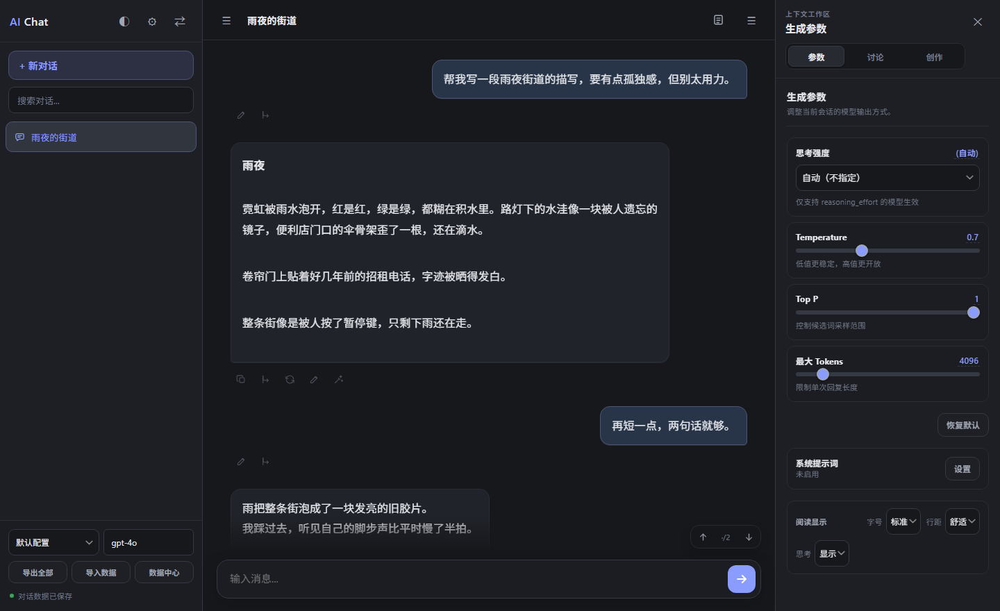
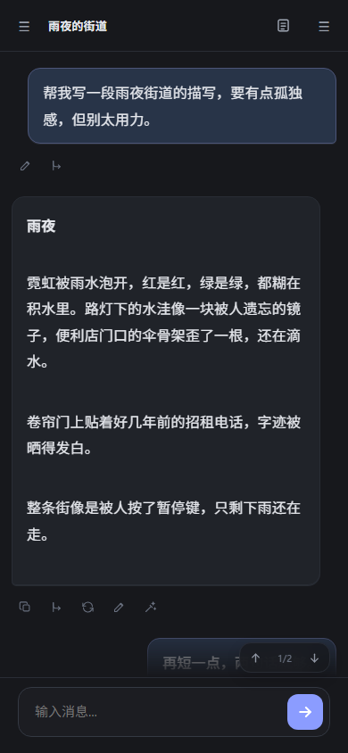

# AI Chat

**本地优先的 AI 写作与对话客户端 —— 同一套前端代码，跑在浏览器和 Android 上。**



## 特性

- **双端同源**：一份 HTML/CSS/JS，浏览器直接打开，安卓端用 WebView 打包成 APK
- **不绑定服务商**：兼容 OpenAI 与 Gemini 接口，任何兼容端点都能接（含本地 Ollama / LM Studio / vLLM）
- **为长文写作设计**：世界观、作品记忆、风格模板、讨论区、正文修订，都在同一个会话里
- **本地优先**：会话存 IndexedDB，API Key 存 localStorage，不上传任何服务器
- **四套主题**：清晨 / 深夜 / 石墨 / 玻璃
- **局域网同步**：电脑起一个小服务，手机填地址和口令即可双向同步

## 快速开始

### 桌面端

需要 Python 3.9+（只用来起本地静态服务和 CORS 代理，无第三方依赖）：

```bash
cd ai-chat
python server.py
```

打开 <http://localhost:5200>。Windows 也可以直接双击 `ai-chat/start.bat`。

### Android

下载 [Releases](../../releases) 里的 APK 安装，或在 Android Studio 里打开 `android/` 自行构建：

```bash
cd android
./gradlew assembleDebug
```



## 配置模型

设置 → 模型配置，填接口地址、API Key 和模型名。接口地址形如 `https://api.openai.com/v1`，**不要**带 `/chat/completions`。

可以存多套配置，在顶栏随时切换。

## 数据与隐私

所有会话数据保存在浏览器本地（IndexedDB），API Key 也只存在本机，请求直接从浏览器发给你配置的服务商。清除浏览器数据会清空本地内容，建议定期用「导出全部」备份。

## License

[MIT](LICENSE)
